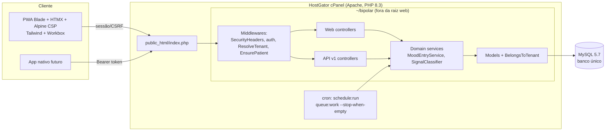
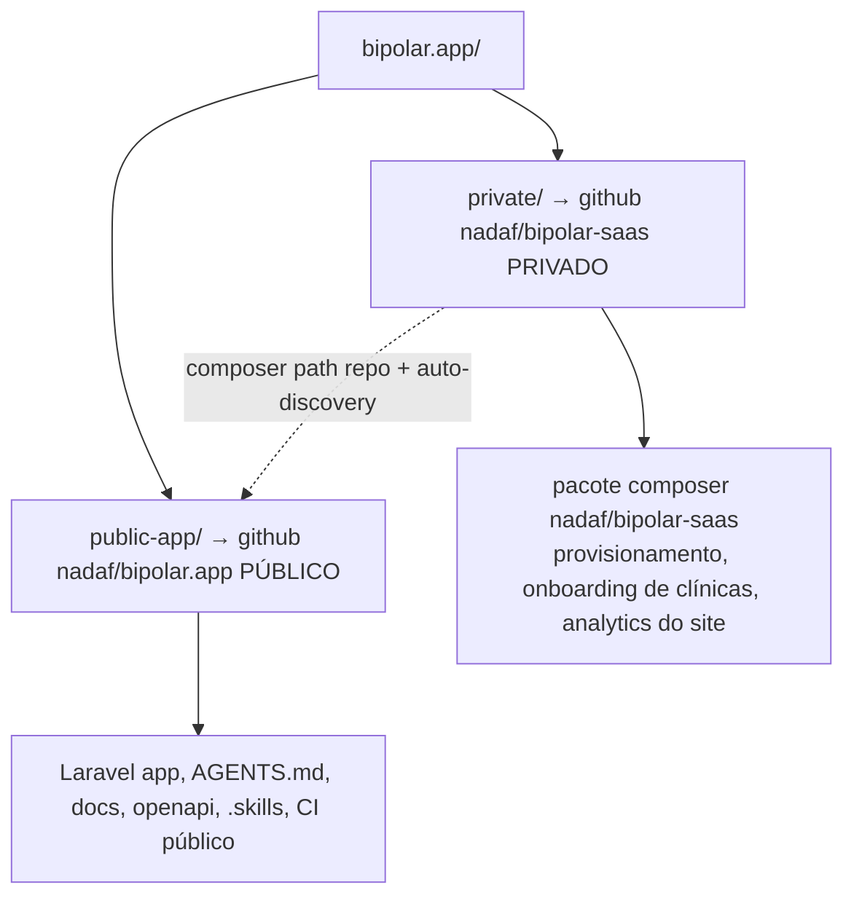
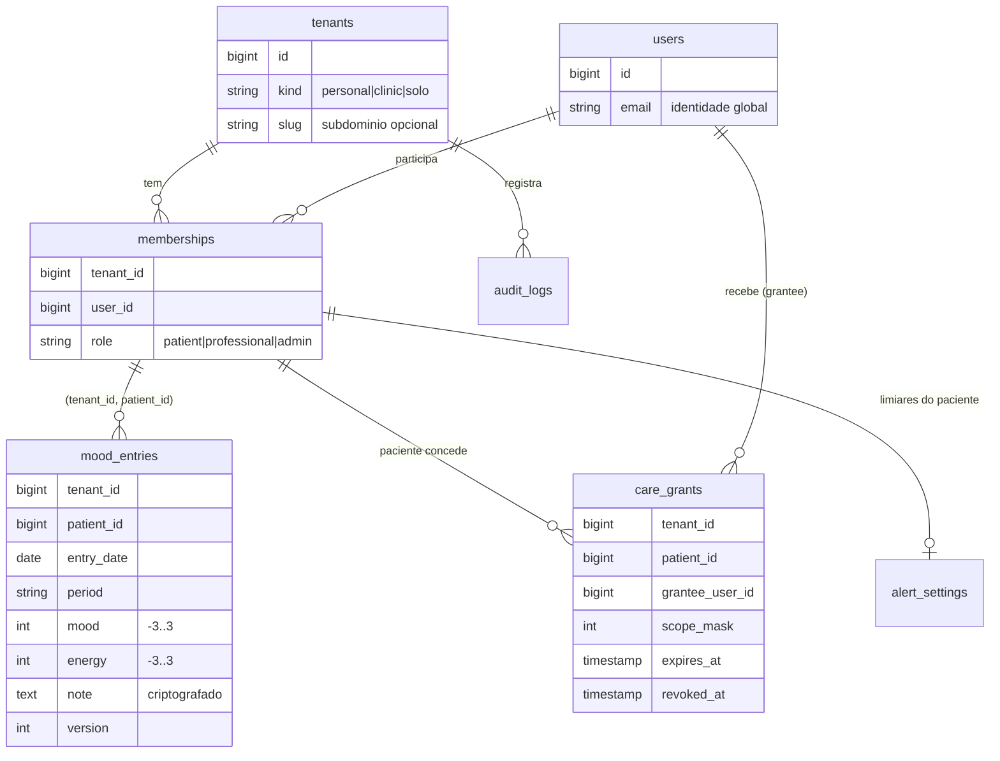
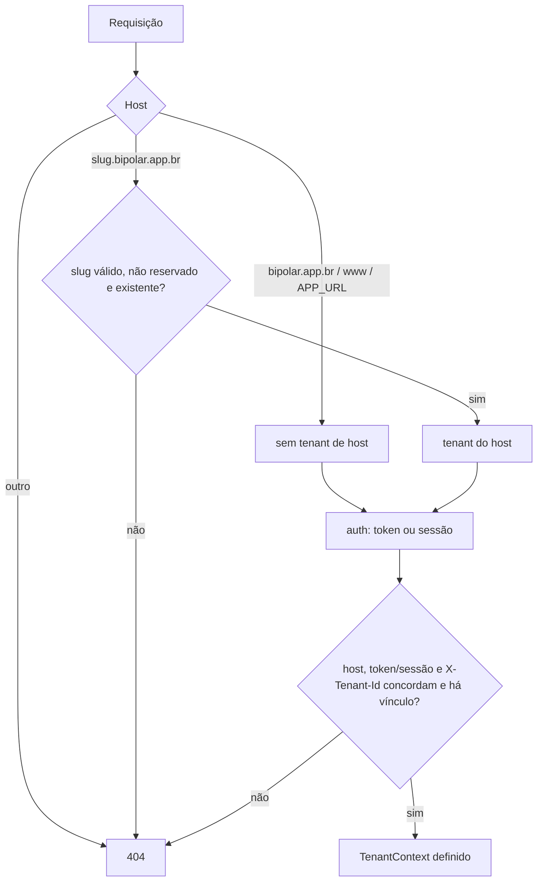

# Arquitetura — Bipolar 2.x

## Visão geral

API-first: toda regra mora em `app/Domain`, exposta por `/api/v1` (JSON, Sanctum) e reutilizada pelas
telas Blade/HTMX (sessão). Apps nativos futuros usam a mesma API e o contrato `openapi/v1.yaml`.



## Layout público x privado



- O público não depende do privado (edição *community*). `private/scripts/build-saas.sh` copia o público,
  instala o pacote e gera o zip SaaS.
- CI público: `.github/workflows/ci-release.yml`. CI privado: `private/.github/workflows/private-ci.yml`
  (clona o público e roda tudo junto).
- `scripts/check-public-tree.sh` bloqueia vazamento de código privado/segredos no público.

## Modelo de dados (núcleo)



- **Tenant** = clínica (admin + vários profissionais e pacientes), **profissional solo** (tenant com um
  único profissional) ou **pessoal** (paciente independente). Cada um pode ter subdomínio opcional.
- **User** é identidade global; o vínculo com tenants é por `memberships` (um paciente tem exatamente
  um vínculo `patient`). Profissional pode ter vínculos em várias clínicas.
- FKs compostas `(tenant_id, patient_id) → memberships(tenant_id, user_id)` garantem no banco que o
  paciente pertence ao tenant da linha.

## Resolução de tenant por host



## Fluxo de requisição (registro de humor)

```mermaid
sequenceDiagram
  participant C as Cliente (PWA/App)
  participant M as Middlewares
  participant S as MoodEntryService
  participant DB as MySQL
  C->>M: PUT /api/v1/entries {entry_date, period, mood, energy, version}
  M->>M: auth:sanctum → user
  M->>M: ResolveTenant (membership do user) → TenantContext
  M->>M: EnsurePatient (role=patient)
  M->>S: dados validados (sem tenant_id/patient_id do cliente)
  S->>S: trava de período (não futuro; passado sem limite)
  S->>DB: SELECT … WHERE tenant_id=? AND patient_id=? FOR UPDATE
  alt versão diferente
    S-->>C: 409 Conflict
  else
    S->>DB: INSERT/UPDATE (version+1) + audit_logs
    S-->>C: 201/200 + signal (depressivo|maniaco|misto|neutro)
  end
```

## Trava de período (Manhã/Tarde/Noite)

O cliente envia **explicitamente** `entry_date` + `period` escolhidos quando o registro começou; o servidor
nunca deduz pelo relógio. A tela mostra "Registrando: Tarde de 30/10" fixo e avisa se o relógio mudou.
Servidor recusa período que ainda não começou (fuso do paciente; manhã 00h, tarde 12h, noite 18h). Dias
passados não têm limite. Edição concorrente usa `version` (409 em conflito).

## Front-end

- Blade renderiza no servidor; HTMX envia formulários e troca fragmentos; Alpine (build CSP) só para
  pequenos estados (rótulo selecionado, aviso de período).
- Sem inline JS/CSS → CSP `script-src 'self'; style-src 'self'`.
- Workbox: precache só de `build/assets/*`, manifest e `offline.html`; navegação e `/api` = NetworkOnly.

## Tarefas assíncronas

Sem processo residente no cPanel: cron por minuto → `schedule:run` → `queue:work --stop-when-empty --max-time=50`.
Fila no banco (`jobs`). Lembretes/relatórios entram como jobs com tenant explícito (`TenantContext::run`).

## Próximos módulos (contrato já no OpenAPI)

Marcadores do dia, módulos privados (step-up), grade semanal de lembretes, relatórios, concessões/convites,
exportação (LGPD art. 18), conta (MFA TOTP, exclusão).
